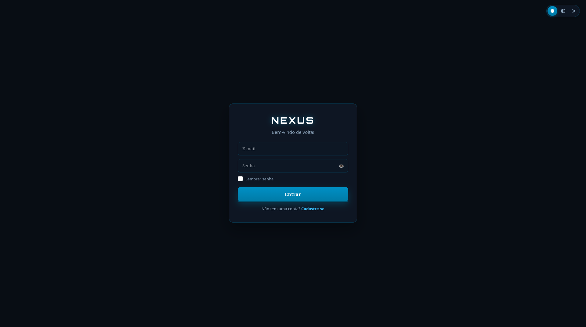
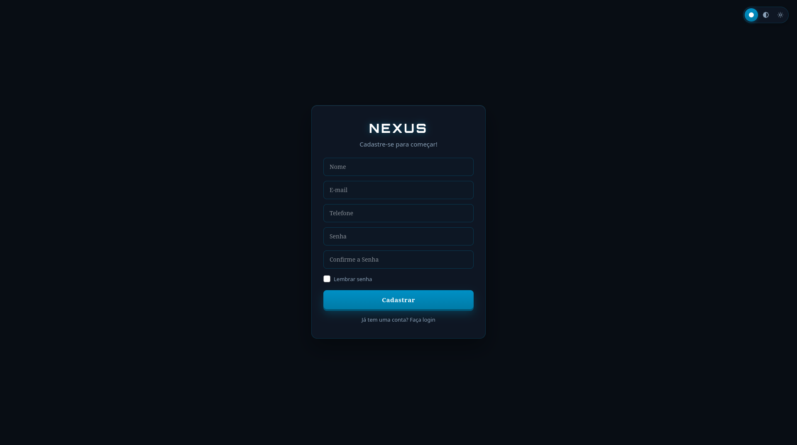
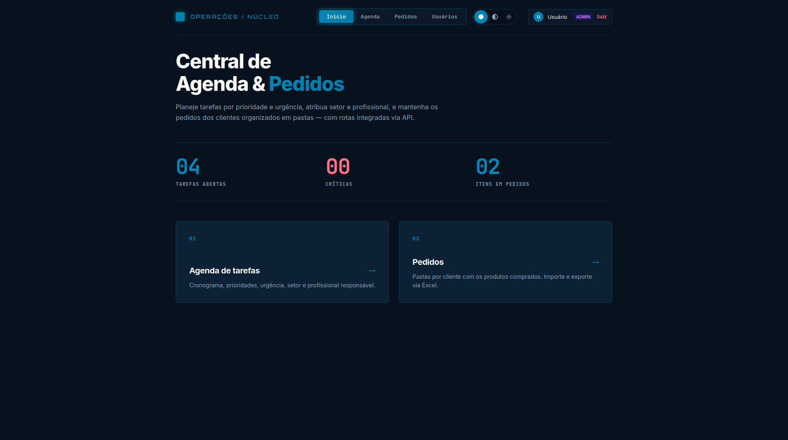
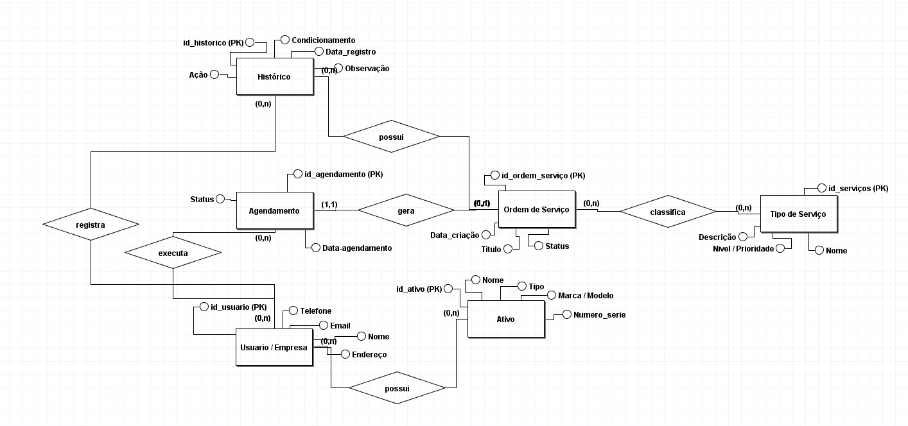
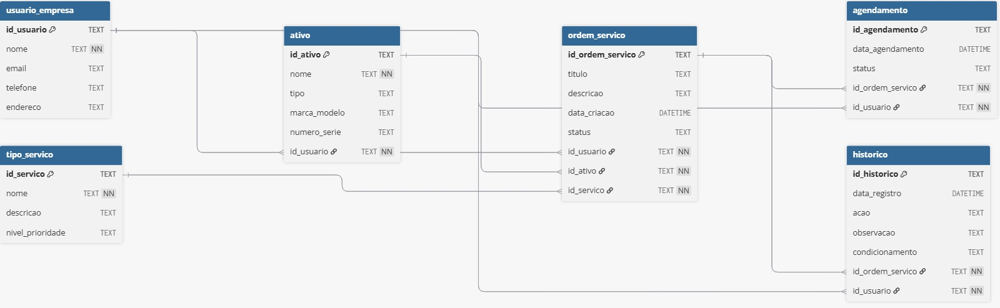

# 📅 Sistema de agendamento 

Sistema Web para agendamento de tarefas, desenvolvido com foco em organização e produtividade.

## 🗺️ Roadmap do Projeto

### ✅ Concluído (Base do Sistema)
- [x] Modelagem inicial do banco de dados (SQLite).
- [x] CRUD completo de usuário e agendamentos.
- [x] Funcionalidade de verificação de horários disponíveis.

### 🚀 Versão 2.0 — Evolução e Expansão do Sistema

- Segunda versão do projeto, com melhorias estruturais, novas funcionalidades e modernização do ambiente de execução.
 #### Arquitetura e Infraestrutura
- [x] Migração de banco de dados para PostgreSQL para maior escalabilidade.
- [x] Implementação do Alembic para versionamento do esquema de banco de dados.
- [x] Conteinerização da aplicação utilizando Docker.
- [x] configuração e gerenciamento dos serviços com Docker Compose.
- [x] Utilização de variáveis de ambiente para gerenciamento de credenciais e configurações sensíveis.
- [x] Padronização do ambiente de execução para diferentes sistemas operacionais.

#### Gerenciamento de Usuários e Controle de Acesso
- [x] Implementação de três níveis de acesso: COMUM, TÉCNICO e ADMINISTRADOR.
- [x] Definição de permissões específicas para cada perfil.
- [x] Restrição de acesso às informações conforme o nível de autorização.
- [x] Implementação de gerenciamento administrativo de usuários.
- [x] Funcionalidade de promoção de usuários COMUM para TÉCNICO.

#### Gerenciamento de Tarefas
- [x] Interface e funcionalidades adaptadas aos diferentes perfis de usuários.
- [x] Visualização individual de tarefas para usuários COMUM.
- [x] Visualização e gerenciamento de tarefas de todos os usuários para TÉCNICOS.
- [x] Criação e gerenciamento administrativo de tarefas.
- [x] Implementação de funcionalidades específicas para resolução de tarefas.

#### Interface e Experiência do Usuário
- [x] Implementação de personalização visual.
- [x] Disponibilização de temas claro, escuro e intermediário.
- [x] Adaptação da interface conforme o perfil de acesso.

#### Interface e Usabilidade
- [x] Refatoração completa da Interface de Usuário (UI).
- [x] Ajustes de responsividade para dispositivos móveis.

### 🚧 Próximas Atualizações
#### Novas Funcionalidades
- [ ] Integração com sistema de notificações (Email/WhatsApp).
- [ ] Dashboard analítico com métricas de agendamento para administradores.

#### Automação e Entrega
- [ ] Configuração de pipeline de CI/CD via GitHub Actions.

## 🚀 Tecnologias Utilizadas


---
## 🔐 Segurança


---
## 🛠️ Fluxo de Desenvolvimento

### Estratégia de Branching
Este projeto utiliza o modelo de ramificação para garantir a estabilidade da versão principal e organizar o trabalho em equipe:

* **`main`**: Contém o código estável e pronto para uso (produção).
* **`develop`**: Branch de integração para novas funcionalidades antes de irem para a main.
* **`feature/nome-da-feature`**: Branches temporárias para o desenvolvimento de recursos específicos (ex: `feature/agendamento-apscheduler`).

---

## 📌 Funcionalidades

* **Cadastro e histórico de clientes:** Armazena dados dos clientes e histórico de agendamentos para agilizar o atendimento e personalizar o serviço.
* **Planejamento de Tarefas:** Permite que clientes marquem, reagendem ou cancelem consultas/serviços a qualquer hora.
* **Calendário e Disponibilidade em Tempo Real:** Exibe horários disponíveis instantaneamente, evitando choques de agenda e duplicidade de marcações.
* **Gestão de Fila de Espera:** Organiza automaticamente quem aguarda uma vaga, preenchendo horários vagos rapidamente em caso de cancelamento.

---

## ⚙️ Como Executar o Projeto

A partir da versão 2.0, o projeto utiliza Docker e Docker Compose para padronizar o ambiente de execução. Isso permite executar a aplicação em diferentes sistemas operacionais, sem a necessidade de instalar manualmente o Python, suas dependências ou o PostgreSQL.

##### 1. Pré-requisitos

Antes de iniciar, certifique-se de possuir:

- Git instalado.
- Docker instalado.
- Docker Compose disponível.

##### 2. Clone o Repositório

Abra o terminal e execute:

```bash
git clone https://github.com/W1ll-Amorim/Sistema_agendamento.git
```

Acesse a pasta do projeto:

```bash
cd Sistema_agendamento
```

##### 3. Configure as Variáveis de Ambiente

Na raiz do projeto, crie um arquivo chamado `.env`.

Esse arquivo será responsável por armazenar as credenciais e configurações individuais do banco de dados PostgreSQL.

Crie o arquivo utilizando:

```bash
touch .env
```

Adicione a seguinte estrutura ao arquivo:

```env
# Configurações do PostgreSQL
DB_USER=seu_usuario
DB_PASSWORD=sua_senha
DB_NAME=sistema_agendamento
DB_HOST=db
DB_PORT=5432

# URL de conexão com o banco de dados
DATABASE_URL=postgresql://${DB_USER}:${DB_PASSWORD}@db/${DB_NAME}
```

**Personalize as configurações:**

- `DB_USER`: defina um usuário próprio para o banco de dados.
- `DB_PASSWORD`: crie uma senha própria e segura.
- `DB_NAME`: escolha o nome do banco de dados.
- `DB_HOST`: mantenha o valor `db`, correspondente ao serviço PostgreSQL no Docker Compose.
- `DB_PORT`: mantenha a porta `5432`, padrão do PostgreSQL.
- `DATABASE_URL`: representa a URL de conexão utilizada pela aplicação.

**Importante:**

- O arquivo `.env` deve estar na raiz do projeto, no mesmo nível do `docker-compose.yml`.
- Utilize suas próprias credenciais.
- Não compartilhe seu arquivo `.env`.
- O arquivo está incluído no `.gitignore` e não deve ser enviado ao GitHub.
- Mantenha a estrutura da variável `DATABASE_URL` para garantir a conexão com o banco de dados.

##### 4. Valide a Configuração

Após criar o arquivo `.env`, execute:

```bash
docker compose config
```

Esse comando verifica a configuração do Docker Compose e a resolução das variáveis de ambiente.

##### 5. Construa e Inicie os Containers

Execute:

```bash
docker compose up -d --build
```

O Docker Compose será responsável por:

- Construir a imagem da aplicação.
- Criar o container da aplicação.
- Criar o container do PostgreSQL.
- Configurar a comunicação entre os serviços.
- Inicializar o ambiente de execução.

##### 6. Verifique os Containers

Para verificar se os serviços estão em execução:

```bash
docker compose ps
```

Para acompanhar os logs:

```bash
docker compose logs -f
```

Para sair da visualização dos logs, pressione `CTRL + C`. Os containers continuarão em execução.

##### 7. Acesse a Aplicação

Após a inicialização dos containers, acesse:

**Aplicação Web:**  
http://localhost:8000

**Documentação da API (Swagger):**  
http://localhost:8000/docs

##### 8. Encerrando a Aplicação

Para interromper e remover os containers:

```bash
docker compose down
```

Esse comando preserva os dados armazenados nos volumes do PostgreSQL.

**Atenção:** Evite utilizar `docker compose down -v` caso queira preservar os dados do banco de dados, pois essa opção também remove os volumes associados ao projeto.

## 📸 Screenshots





## 🗄️ Banco de Dados



## 👨‍💻 Desenvolvedor Principal
<div align="center">
  <a href="https://github.com/W1ll-Amorim">
    <br>
    <sub><b>Wiliam de Amorim</b></sub>
  </a>
  <br>
  <i>Desenvolvedor Fullstack</i>
  <br><br>
  <a href="https://www.linkedin.com/in/wiliam-amorim-241784331" target="_blank">
    
  </a>
</div>

## 🤝 Contribuidores

<div align="center">
  <table width="100%">
    <tr>
      <td align="center" width="33.3%">
        <a href="https://github.com/LilNavaHoods">
          <br>
          <sub><b>Lohan da Silva</b></sub>
        </a>
        <br>
        <i>Desenvolvedor back-end</i>
        <br><br>
        <a href="https://www.linkedin.com/in/lohan-da-silva" target="_blank">
          
        </a>
      </td>
      <td align="center" width="33.3%">
        <a href="https://github.com/Victoroliveira07">
          <br>
          <sub><b>João Cavalcante</b></sub>
        </a>
        <br>
        <i>Desenvolvedor front-end</i>
        <br><br>
        <a href="https://www.linkedin.com/in/joão-victor-oliveira-cavalcante-720331209" target="_blank">
          
        </a>
      </td>
     <td align="center" width="33.3%">
        <a href="https://github.com/MrFelps">
          <br>
          <sub><b>Felipe Gabriel</b></sub>
        </a>
        <br>
        <i>Desenvolvedor front-end</i>
        <br><br>
        <a href="https://www.linkedin.com/in/felipe-gabriel-boccardo-de-jesus-4b87101a4" target="_blank">
          
        </a>
      </td>
    </tr>
  </table>
</div>

---

## Participantes

| [<br><sub>Gabriel Ferreira</sub>](https://github.com/bielgb13) | [<br><sub>Gustavo Urbano</sub>](https://github.com/Gustavo-Urbano-Alvarenga) |
| :---: | :---: |
